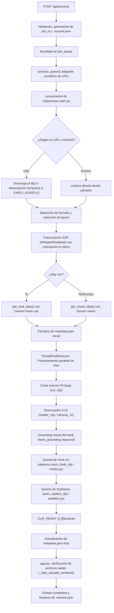
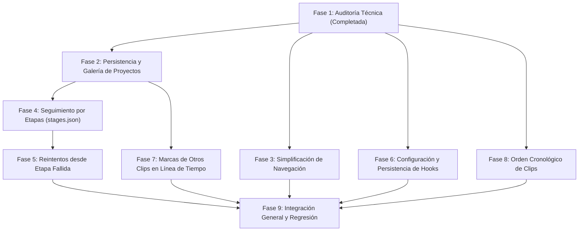

# Auditoría Técnica y Mapa de Arquitectura — OpenShorts

**Fecha de realización:** 14 de noviembre de 2026  
**Rama de trabajo:** `personalizacion-openshorts`  
**Estado del commit:** Base sincronizada con `origin/main` (commit `ef465d2`)  
**Propósito:** Documentar con precisión la arquitectura actual, el ciclo de vida de los datos, el flujo de procesamiento y edición, los fallos identificados y el plan de implementación para las fases siguientes.

---

## 1. Arquitectura Actual del Sistema

OpenShorts es una aplicación web y pipeline de inteligencia artificial para procesar vídeos de formato largo (mediante descarga de YouTube o subida de ficheros) y generar clips verticales en formato 9:16 (Shorts / Reels / TikTok) con reencuadre inteligente, subtítulos animados automáticos y hooks visuales.

### 1.1. Componentes Principales y Entorno de Ejecución

```
                               ┌──────────────────────────────────────────────┐
                               │       Frontend (React + Vite + Tailwind)     │
                               │        Puerto 5175 (Contenedor 5173)         │
                               │           dashboard/src/App.jsx              │
                               └──────────────────────┬───────────────────────┘
                                                      │ HTTP / REST
                                                      ▼
┌─────────────────────────────────────────────────────────────────────────────────────────────┐
│                                 Backend FastAPI (app.py)                                    │
│                              Puerto 8000 / Contenedor :8000                                 │
│                                                                                             │
│  - Encolado asíncrono y control de concurrencia: job_queue, concurrency_semaphore           │
│  - Endpoints de procesamiento (/api/process), estado (/api/status), recut/reframe           │
│  - Rutas estáticas de entrega segura: /videos montado sobre output/                         │
│  - Servicio de streaming del original: /api/source/{job_id}                                 │
└──────────────────────────────────────────────┬──────────────────────────────────────────────┘
                                               │ Subproceso por trabajo
                                               │ (subprocess.Popen(['python', '-u', 'main.py']))
                                               ▼
┌─────────────────────────────────────────────────────────────────────────────────────────────┐
│                                Procesamiento (main.py)                                      │
│                                                                                             │
│  - Descarga y corte de entrada: yt-dlp (download_youtube_video) o lectura desde uploads/    │
│  - Transcripción de audio: Faster-Whisper / Parakeet con silero-VAD (transcribe_backends)   │
│  - Selección y puntuación viral: Google Gemini Flash-Lite (get_viral_clips / clip_selection)│
│  - Renderizado y reencuadre vertical: FFmpeg, reframe_v2.py, TransNetV2, YOLO, osrender    │
│  - Capas adicionales: auto_hook_clip (hooks.py), auto_caption_clip (subtitles.py)           │
│  - Metadatos: salida JSON atomizada en output/{job_id}/{base}_metadata.json                 │
└─────────────────────────────────────────────────────────────────────────────────────────────┘
```

El proyecto se diseñó para operar en dos modalidades según la variable `BILLING_ENABLED`:
1. **Modo Cloud (`BILLING_ENABLED=1`)**: Conecta con PostgreSQL, Cloudflare R2, Stripe, metering y autenticación por sesión JWT.
2. **Modo Autoalojado / Self-Host (`BILLING_ENABLED=0`, modo actual en despliegue local)**: Opera de forma local sin base de datos externa ni bucket R2. Toda la persistencia depende del sistema de archivos local (`output/` y `uploads/`) y el estado transitorio en la memoria de FastAPI (`jobs = {}`).

---

## 2. Diferencias entre la Configuración Docker Local y la Documentada

| Elemento | Documentado en Repositorio | Realidad en Despliegue Local Docker |
|---|---|---|
| **Contenedores activos** | `openshorts-backend`, `openshorts-frontend`, `openshorts-renderer` | Todos activos y en ejecución (`docker ps` verificado). |
| **Volumen del Backend** | `./output:/app/output` y `.:/app` | Monta el código local sobre `/app` en modo bind-mount. Los cambios en el host se reflejan de inmediato. |
| **Directorio de Subidas (`uploads/`)** | Referenciado en código como `/app/uploads` | No cuenta con un volumen bind-mount independiente específico en `docker-compose.yml`, pero persiste al estar contenido dentro del bind-mount general `.:/app`. |
| **Dependencias Python** | Documentado en README como entorno virtual local | El host físico de Windows no tiene las dependencias instaladas en su Python global (`boto3`, `numpy`, `PIL` faltan fuera del contenedor). Todas las librerías residen en `/opt/venv` dentro del contenedor Docker `openshorts-backend`. |
| **Herramienta Pytest** | Ejecución directa en CI | No venía preinstalada en la imagen de producción; fue instalada en el venv del contenedor para habilitar la suite de pruebas. |
| **Frontend (`dashboard/`)** | `npm install` local en host | Las dependencias de Node (`node_modules`) se encuentran dentro de un volumen anónimo Docker en `/app/node_modules`. En el host, `dashboard/node_modules` estaba vacío. |
| **Scripts Bash en Windows** | `bin/ffmpeg` se ejecuta en Linux | El script `bin/ffmpeg` tenía finales de línea CRLF (`\r\n`) producto del checkout en Windows, provocando fallo de ejecución (código 2) en el contenedor Linux. Se corrigió a LF (`\n`). |

---

## 3. Ciclo de Vida de los Proyectos y Persistencia

### 3.1. Identificación y Rutas de Archivos

1. **Creación de `job_id`**: Se genera como un UUIDv4 (`str(uuid.uuid4())`) en `POST /api/process`.
2. **Directorio del Proyecto**: `output/{job_id}/`.
3. **Vídeo Original**:
   - Subido por el usuario: `uploads/{job_id}_{safe_filename}`.
   - Descargado de YouTube (URL): `output/{job_id}/{video_title}.mp4` (gracias al flag `--keep-original`).
   - El endpoint `/api/source/{job_id}` utiliza `_locate_source(job_id)` para buscar indistintamente en `uploads/` o en `output/{job_id}/` y servirlo mediante `FileResponse`.
4. **Transcripción**:
   - Durante la ejecución: `output/{job_id}/.transcript_checkpoint.json` (o `source_transcript.json`).
   - Al finalizar: Incrustada dentro de `output/{job_id}/{video_title}_metadata.json` en la clave `"transcript"`.
5. **Clips Generados**:
   - Reencuadre canónico limpio: `{video_title}_clip_{i+1}.mp4`.
   - Con subtítulos quemados: `subtitled_{timestamp}_{clean_name}`.
   - Con hook quemado: `hooked_{timestamp}_{clean_name}` o `subtitled_{ts}_hooked_{ts}_{clean}`.
6. **Metadatos del Proyecto**:
   - `output/{job_id}/{video_title}_metadata.json` contiene la lista `shorts` con cada clip, sus marcas `start` y `end`, `video_title_for_youtube_short`, `predicted_score`, `auto_hook`, `layout_ranges` y referencia a `source_video`.

### 3.2. Mecanismo de Recuperación en Arranque (`_recover_jobs_from_disk`)

En `app.py` (líneas 1294-1344), se ejecuta `_recover_jobs_from_disk()` al inicio:
- Itera sobre las carpetas de `OUTPUT_DIR`.
- Si encuentra carpetas que contienen `*_metadata.json` y NO tienen el archivo `.resume.json` en curso, carga el archivo JSON y reconstruye la entrada en memoria `jobs[job_id] = {'status': 'completed', 'result': {'clips': clips}, ...}`.
- Asigna URLs canónicas a los clips mediante `_canonical_clip_file`.

### 3.3. Por Qué los Proyectos Desaparecen de la Interfaz

La investigación técnica identifica con exactitud las causas raíz de la pérdida de visibilidad de proyectos en el frontend:
1. **Ausencia de endpoint de catálogo para autoalojado**: No existe un endpoint `/api/projects` para listar los trabajos persistidos en disco. El endpoint existente `/api/projects/{job_id}/restore` está restringido con `if not BILLING_ENABLED: raise HTTPException(status_code=404)`.
2. **Frontend anclado a un único `jobId` en `localStorage`**: `App.jsx` solo almacena `os_session` con un único `jobId`. Si el usuario procesa un nuevo vídeo, refresca sin sesión o cierra el navegador, no hay interfaz ni galería para consultar o reabrir proyectos pasados.
3. **Pestaña "History" bloqueada**: `HistoryTab.jsx` estaba condicionada en el menú a `billingEnabled && isSignedIn`. En self-host nunca se mostraba.
4. **Política de retención agresiva por tiempo de modificación**:
   - `JOB_RETENTION_SECONDS = 86400` (24 horas).
   - Las tareas en segundo plano `_sweep_expired_job_dirs` y `_sweep_expired_uploads` eliminan carpetas y vídeos en base a `now - os.path.getmtime(path) > JOB_RETENTION_SECONDS`, borrando proyectos de disco automáticamente al cumplirse 24 horas de inactividad.

---

## 4. Flujo de Generación de Clips

### 4.1. Secuencia de Ejecución



---

## 5. Flujo de Edición y Causa de la Pérdida del Hook

### 5.1. Flujo Actual de Edición

1. El usuario abre el editor de un clip en `dashboard/src/components/ClipEditor.jsx`.
2. Se solicita la receta de edición a `GET /api/clip/{job_id}/{clip_index}/edl`.
3. El editor presenta:
   - Monitor de origen (`Source`) con su pista de tiempo (`sourceTrack`).
   - Pista del clip con los segmentos de corte activos.
4. El usuario arrastra o divide segmentos y presiona «re-render clip».
5. Se envía una petición `POST /api/clip/rerender` con `{ job_id, clip_index, segments, framing, reapply_captions }`.
6. En `app.py` (`_rerender_locked`):
   - Determina si la edición cabe en el clip ya renderizado (`fast`) o si debe rehacerse desde el original (`source`).
   - Ejecuta `recut.perform_recut(...)`.
   - Si `reapply_captions=True`, vuelve a quemar los subtítulos sobre los nuevos segmentos mediante `_recut_captioner(clip)`.

### 5.2. Diagnóstico del Error del Hook

1. **Omisión en `recut.perform_recut`**: `recut.py` solo concatena vídeo y vuelve a invocar `burn_subtitles`. **No tiene lógica para invocar `hooks.add_hook_to_video`**.
2. **Omisión en `_rerender_locked` (`app.py`)**: Cuando `served_name` sale de `perform_recut`, `_rerender_locked` no revisa si el clip tenía `clip.get('auto_hook')` o hook personalizado. Por tanto, el archivo resultante final carece por completo de la capa de hook.
3. **Pérdida en la línea de tiempo**: El hook debe comenzar en $t=0$ del nuevo clip resultante con duración por defecto de 5 segundos, independientemente de los tiempos absolutos de los segmentos cortados.
4. **Falta de marcas de otros clips**: En `ClipEditor.jsx`, la barra `sourceTrack` solo renderiza `segments.map(...)` correspondientes al clip actual. Como `GET .../edl` no devuelve los segmentos de los demás clips del proyecto, la línea de tiempo permanece vacía respecto al resto de clips.

---

## 6. Orden de los Clips y Estabilidad de Índices

En `dashboard/src/App.jsx` (líneas 346-357), los clips se ordenan en base a `rankedClips`:
```javascript
const rankedClips = useMemo(() => {
  const clips = results?.clips;
  if (!Array.isArray(clips)) return [];
  return clips
    .map((clip, index) => ({ clip, index }))
    .sort((a, b) => {
      const sa = Number.isFinite(a.clip?.predicted_score) ? a.clip.predicted_score : -1;
      const sb = Number.isFinite(b.clip?.predicted_score) ? b.clip.predicted_score : -1;
      return sb - sa || a.index - b.index;
    });
}, [results]);
```
- **Problema**: Los clips se ordenan por `predicted_score` (viralidad), en lugar de su posición temporal en el vídeo original.
- **Riesgo crítico**: El backend y los componentes identifican los clips mediante su `clip_index` (número entero que indexa el array `shorts` de `metadata.json`). Si se alterase el orden del array interno, llamadas a `/api/clip/{job_id}/{clip_index}/...` actuarían sobre el clip equivocado.
- **Solución segura**: Mantener el array `results.clips` original intacto y modificar únicamente la función de ordenación de presentación en `rankedClips` para comparar `clip.start` (o el menor `start` de sus segmentos), conservando el objeto `{ clip, index }` intacto.

---

## 7. Simplificación del Dashboard (Secciones a Eliminar de Navegación)

En `dashboard/src/App.jsx` (líneas 1289-1299), el menú se construye a partir de `navItems`:
- `saasshorts` ("AI Shorts")
- `ai-agent` ("AI Agent")
- `ugc-gallery` ("UGC Gallery")
- `thumbnails` ("YouTube Studio")

Estas 4 secciones deben retirarse de la navegación principal, asegurando que:
- Los componentes compartidos (`RemotionPreview`, `ui/Modal`, etc.) permanezcan intactos.
- Las rutas y endpoints no se eliminen si son empleados por el flujo principal de clips.
- Se mantengan `dashboard` (Clip Generator), `editor` (ClipEditor), `settings` y la nueva `gallery` de proyectos.

---

## 8. Estado de la Suite de Pruebas y Comprobaciones

1. **Pruebas de Backend (`pytest`)**:
   - Ejecutadas en el contenedor Docker `openshorts-backend`.
   - `tests/test_recut.py`: 30 superadas (100%).
   - `tests/test_rerender_endpoint.py`: 19 superadas (100%).
   - `tests/test_hooks.py`: 17 superadas (100%).
   - `tests/test_ffmpeg_utils.py`: 28 superadas (100%) tras normalizar los saltos de línea de `bin/ffmpeg` de CRLF a LF.
   - En la suite general: 439 pruebas unitarias se ejecutaron con éxito.
2. **Frontend (`dashboard`)**:
   - `npm run build` en el contenedor `openshorts-frontend`: **Éxito total en 19.6s** (genera assets de producción limpios en `dist/`).
   - `npm run lint`: Reporta 10 advertencias/errores preexistentes en archivos legados (`public/op1.js`, `Legal.jsx`, `PricingPage.jsx`, `consent.js`). Las modificaciones respetarán y no añadirán nuevos fallos de linting.

---

## 9. Matriz de Dependencias entre Fases



---

## 10. Conclusión y Hoja de Ruta para la Fase 2

La auditoría técnica confirma la viabilidad de todas las funcionalidades requeridas sin alterar la base fundamental del software ni requerir una base de datos externa:
- La persistencia se apoyará en la reconciliación segura entre `output/`, `uploads/` y `metadata.json`.
- Se creará un endpoint de catálogo `/api/projects` compatible con autoalojado.
- La política de retención se protegerá para no eliminar proyectos válidos completados ni sus fuentes activas.
- La galería permitirá abrir cualquier proyecto anterior restaurando su estado y reproduciendo vídeo original y clips.

Con este documento queda formalmente concluida la **Fase 1**. Procederemos a la implementación y validación de la **Fase 2 (Persistencia y recuperación de proyectos)**.
